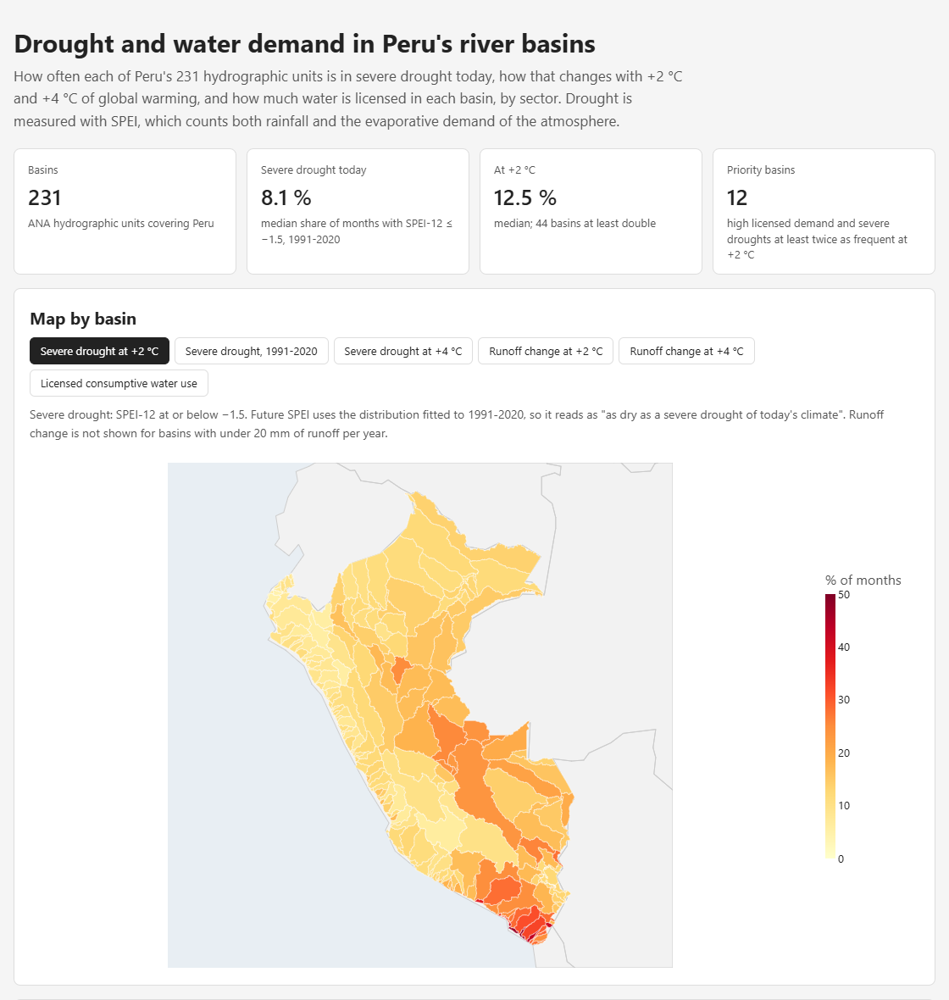

# Drought and water demand in Peru's river basins

**How often each of Peru's 231 hydrographic units is in severe drought today, how that changes with +2 °C and +4 °C of global warming, and how much water is licensed in each basin, by sector.**

Dashboard: https://cristhianbgf.github.io/peru-basin-drought/



## Why

Peru monitors drought with indices based on rainfall alone (SPI) and on river flow anomalies. Rainfall-only indices miss the drying caused by higher evaporative demand, which is the part of drought that grows most clearly with warming. Water use rights, on the other hand, are published by the National Water Authority (ANA) right by right, without being related to drought.

This repository puts both on the same map for every hydrographic unit:

- **Hazard:** SPEI (Standardized Precipitation-Evapotranspiration Index), which uses rainfall minus Penman-Monteith reference evapotranspiration, from 1958 to 2025 and under +2 °C and +4 °C of global warming.
- **Demand:** the volume licensed to each sector (agriculture, public supply, mining, industry and others), summed over about 510 000 water use rights in force.

It is a national screening for planning, environmental assessment and water-related project risk, not a substitute for a basin water balance study.

## Key findings

Figures from [`outputs/basin_indicators.csv`](outputs/basin_indicators.csv) and [`outputs/validation_events.csv`](outputs/validation_events.csv). Severe drought means SPEI-12 at or below −1.5.

| | 1991–2020 | +2 °C | +4 °C |
|---|---|---|---|
| Median share of months in severe drought (174 non-hyper-arid basins) | 8.1 % | 12.5 % | 17.9 % |

- **Twelve priority basins** combine high licensed demand (top third) with severe droughts at least twice as frequent at +2 °C. Most are in southern Peru: Quilca-Vítor-Chili, Camaná, Tambo, Locumba and Ilo-Moquegua on the Pacific side, Azángaro and Pucará in the Titicaca basin, and the Urubamba and Huallaga units in the Amazon. Three of them (Chili, Locumba and Ilo-Moquegua) hold about 100 hm³/yr of water licensed to mining.
- **Validation:** the six droughts documented in the literature that were checked all fall in the driest 17 % of months of their region since 1959. The strongest, 1991–92 in the Altiplano and 2023 in the Amazon, are in the driest 2 % and 4 %.

## Method

| Step | What it does | Script |
|---|---|---|
| 1 | Downloads TerraClimate v1.1 precipitation, reference evapotranspiration and runoff (monthly, ~4 km) cropped to Peru, for 1958–2025 and the +2 °C and +4 °C versions | `scripts/download_terraclimate.py` |
| 2 | Downloads ANA's 231 hydrographic units and the water use rights in force, aggregated per unit and sector on ANA's servers | `scripts/download_ana.py` |
| 3 | Averages the grids over each unit (cell centres inside the unit, weighted by cos latitude) | `scripts/build_basin_series.py` |
| 4 | SPEI-3 and SPEI-12 per unit (log-logistic distribution fitted per calendar month on 1991–2020 with xclim), drought frequency now and at +2 °C / +4 °C, trends, runoff change and priority basins | `scripts/compute_indicators.py` |
| 5 | Checks SPEI against documented droughts | `scripts/validate_events.py` |
| 6 | Builds the static dashboard in `docs/` | `scripts/build_dashboard.py` |

The future SPEI uses the distribution fitted to today's climate, so a value below −1.5 at +2 °C means "as dry as a severe drought of today's climate". Hydropower, aquaculture and fishing are not counted as consumptive use.

## Why there is no water stress ratio

A natural next step would be licensed use divided by available water. It is not done here on purpose: TerraClimate runoff comes from a simple monthly water balance without glacier melt or inflow from upstream basins, and in Pacific basins it is well below gauged flows (for example about 14 m³/s for the whole Rímac basin). A ratio built on it would exaggerate stress, by more than a thousand times in some coastal units. Runoff is used only as a relative change, and only where it exceeds 20 mm per year.

## Limitations

- The +2 °C and +4 °C series apply one pattern of change to the observed record (a pseudo-warming experiment). They do not show the spread between climate models, and they keep today's year-to-year variability.
- In the 57 hyper-arid coastal units (aridity index below 0.05) SPEI mostly reflects evaporative demand; they are flagged and left out of the priority analysis. Their water comes from Andean basins upstream.
- Licensed volume is what a right allows, not what is used. About 220 of the 2 716 rights without a basin code could not be placed in any unit.
- Region-wide SPEI dilutes local droughts: the Amazon events of 2010 and 2016 appear weaker than in basin-level studies.

## Repository structure

```
peru-basin-drought/
├── scripts/      # download, processing, indicators, validation and dashboard
├── outputs/      # indicator tables (CSV/Parquet) used by the dashboard
├── docs/         # dashboard published with GitHub Pages
├── tests/        # pytest: basin weights and SPEI calibration
└── environment.yml
```

Raw data are not versioned; the scripts download them again.

## How to reproduce

```bash
conda env create -f environment.yml
conda activate peru-drought
pytest
python scripts/download_terraclimate.py   # about 35 min, 760 MB
python scripts/download_ana.py
python scripts/build_basin_series.py
python scripts/compute_indicators.py      # about 15 min (one distribution fit per basin and month)
python scripts/validate_events.py
python scripts/build_dashboard.py
```

## Data sources

- Abatzoglou, J. T., Hegewisch, K. C., Yin, C. and Kalashinkov, D. A. (2026). TerraClimate v1.1: an updated global climate and climatic water balance dataset with climate scenarios. *Scientific Data*. Licence CC0 1.0.
- Autoridad Nacional del Agua (ANA): hydrographic units (via the national spatial data portal, IDEP) and water use rights (GeoSNIRH).
- Vicente-Serrano, S. M., Beguería, S. and López-Moreno, J. I. (2010). A multiscalar drought index sensitive to global warming: the Standardized Precipitation Evapotranspiration Index. *Journal of Climate* 23, 1696–1718.

## Author

Cristhian Brandon Gamarra Fuentes, BSc in Environmental Engineering (Universidad Andina del Cusco).

## Licence

Code under the MIT licence ([LICENSE](LICENSE)).
